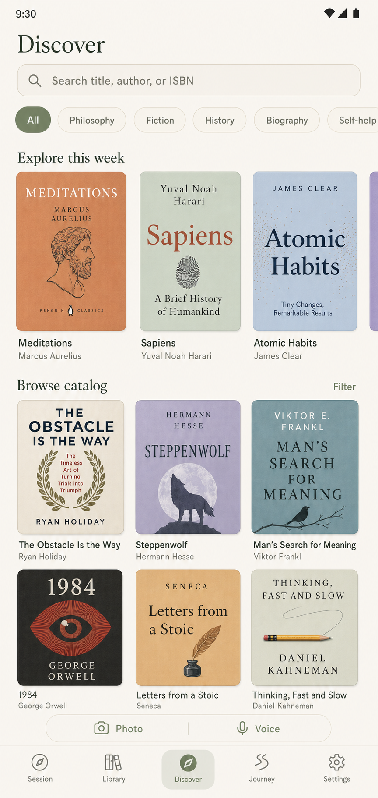

# BookBite

BookBite is a calm, private, offline-first companion for readers of physical books.

<p align="center">
  
  &nbsp;&nbsp;
  
</p>


## Open Library configuration

Discover uses the Open Library API only after a human reader starts a browse or
search action. Open Library requires an identifying User-Agent and contact
email for this level of use. Put the approved contact in the local, ignored
`.env` file before running the app:

```dotenv
OPEN_LIBRARY_CONTACT=your-email@example.com
```

Then run normally:

```powershell
flutter run
```

The Discover page remains usable without this setting: it clearly explains
that the catalog is unavailable and exposes manual book creation. An Android
device/emulator needs normal internet access to fetch live catalog summaries
and cover thumbnails. Cached catalog information remains separate from the
reader's local books and reading data.
